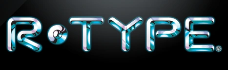
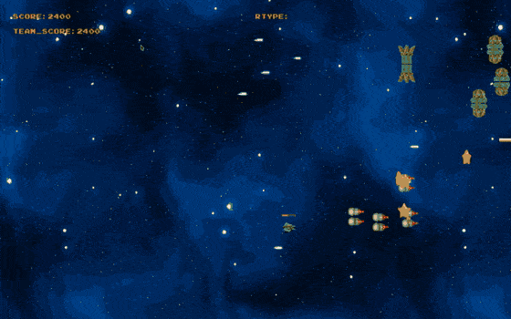
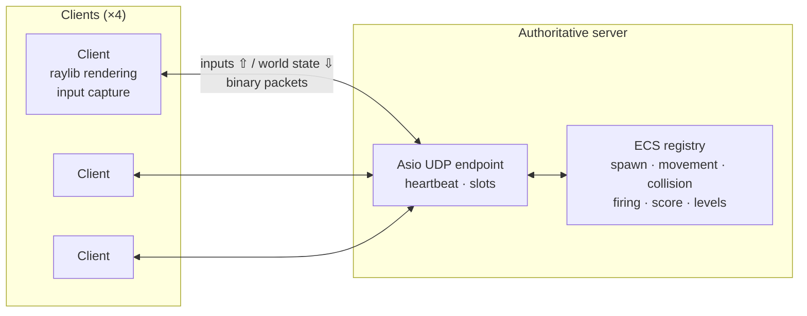

<div align="center">



# R-Type: a multiplayer arcade shooter in modern C++

**A 4-player networked remake of the 1987 arcade classic, built from scratch on a custom ECS game engine and a UDP binary protocol.**

[](https://github.com/yanishk/r-type/actions/workflows/build-linux.yaml)
[](https://github.com/yanishk/r-type/actions/workflows/build-macos.yaml)
[](https://github.com/yanishk/r-type/actions/workflows/clang-format.yaml)




[Quick start](#quick-start) · [Architecture](#architecture) · [Network protocol](#network-protocol) · [Documentation](#documentation) · [Team](#team)

</div>

---

## About

R-Type is the Advanced C++ project of Epitech's third year. The brief: rebuild the arcade game **as a multiplayer title**, with a dedicated server and graphical clients that stay in sync in real time, and do it on top of a **game engine designed by the team**, not an off-the-shelf one.

The result is a playable co-op shooter for **up to 4 players**, three levels with their bosses, power-ups, weapon pickups, difficulty modes and controller support, shipped with CI on Linux and macOS and a Doxygen-generated API reference.

## Highlights

- **Custom ECS game engine**: entities, components and systems are decoupled through a registry and sparse arrays; adding a mechanic is a matter of writing one system and registering it.
- **Authoritative server over UDP**: the server owns the game state (spawns, collisions, scoring); clients only send inputs and render what they are told. Asynchronous I/O with Asio, multi-threaded on both sides.
- **Compact binary protocol**: every packet carries a magic number, a type, an ID and a size, so malformed or foreign packets are dropped before parsing. Formally described in an RFC-style spec.
- **Heartbeat & reconnection slots**: clients prove liveness every second; a silent client is dropped after 5 s and its slot is freed for a new player.
- **Gameplay depth**: 3 levels, 3 bosses, 4 power-ups (extra life, power shot, invincibility, mega shot), front/back weapon pickups, enemy movement patterns, `easy` / `medium` / `hard` difficulty and optional friendly fire.
- **Accessibility**: fully playable with a gamepad for players with motor disabilities.
- **Engineering hygiene**: Conventional Commits, `clang-format` enforced in CI, Linux and macOS build pipelines, Doxygen docs with a custom theme.

## Quick start

### Prerequisites

| Tool | Notes |
|------|-------|
| Git, CMake ≥ 3.14, a C++17 compiler | all platforms |
| X11 / OpenGL dev headers | Linux only (`libxinerama-dev libxcursor-dev xorg-dev libglu1-mesa-dev`) |
| MinGW, PowerShell 7, 7-Zip | Windows only (experimental) |

Dependencies (raylib, Asio, GLFW) are fetched and built automatically through **vcpkg** on the first configure, so there is nothing to install by hand.

### Build

```bash
git clone https://github.com/yanishk/r-type.git
cd r-type
cmake -P build.cmake      # bootstraps vcpkg + configures
cmake --build build       # produces ./rtype_server and ./rtype_client
```

To start from a clean tree: `cmake -P build/clean.cmake`.

### Run

```bash
# 1. Start a server (one lobby, up to 4 players)
./rtype_server 4242 --difficulty hard --friendlyfire true

# 2. Start one client per player
./rtype_client 127.0.0.1 4242
```

| Flag | Values | Default |
|------|--------|---------|
| `--difficulty` | `easy`, `medium`, `hard` | `medium` |
| `--friendlyfire` | `true`, `false` | `false` |

> [!NOTE]
> Server and clients must use the same port.

### Controls

| Keyboard | Gamepad | Action |
|----------|---------|--------|
| Arrow keys | Left stick / D-pad | Move |
| Space | Right trigger | Shoot |

## Architecture



The game logic lives in **systems** that iterate over **component** arrays owned by a **registry**. The same engine runs on both sides: the server executes gameplay systems (spawning, collisions, firing, score, level progression), the client executes presentation systems (sprite drawing, animation, sound, music, life bar). Components that cross the network implement `operator==` and stream serialisation, so only changed state is sent.

```
src/
├── ecs/            Engine: Registry, SparseArray, components, 25+ systems
├── network/        INetwork / ANetwork, Asio UDP server & client, packet (de)serialisation
├── games/          IGame / AGame and the R-Type server & client game definitions
├── runGame/        Main loop glue
lib/                Platform helpers (screen size, timers…)
include/            Error handling, DLLoader, asset paths
assets/             Sprites, music, SFX, arcade font
documentation/      Doxygen config, custom theme, protocol RFC
.github/workflows/  Linux & macOS builds, clang-format check
```

## Network protocol

Every datagram follows the same layout:

```
┌──────────────┬──────────────┬────────────┬──────────────┬──────────────┐
│ Magic number │ Message type │ Message ID │ Message size │   Payload    │
│   2 bytes    │    1 byte    │  2 bytes   │   2 bytes    │  variable    │
└──────────────┴──────────────┴────────────┴──────────────┴──────────────┘
```

- The magic number (`0x9B3D`) rejects packets that do not belong to the game.
- The server never waits for acknowledgements: fluidity is favoured over strict consistency, which suits an arcade shooter.
- Liveness is handled by a heartbeat (client → server every second; 5 s timeout server-side), and connections/disconnections are broadcast to every client.

The full specification is in [`documentation/docs/RFC.txt`](documentation/docs/RFC.txt).

## Documentation

| Topic | Where |
|-------|-------|
| Game engine (ECS, how to add a component or a system) | [`src/ecs/README.md`](src/ecs/README.md) |
| Game layer (registering entities, components, systems) | [`src/games/README.md`](src/games/README.md) |
| Networking (server, client, heartbeat) | [`src/network/README.md`](src/network/README.md) |
| Binary protocol specification | [`documentation/docs/RFC.txt`](documentation/docs/RFC.txt) |
| API reference | `doxygen documentation/Doxyfile` → `documentation/html/index.html` |

## Team

Built in 7 weeks (Sept–Nov 2024) by five Epitech students:

| | Main areas |
|---|---|
| [**Yanis Harkouk**](https://github.com/yanishk) | ECS engine, UDP networking & serialisation, game server (difficulty modes, friendly fire), CI |
| [**Mathis Brehm**](https://github.com/mathisbdkr) | Weapons & power-ups, music per level, assets, engine docs |
| [**Wilson Bordichon**](https://github.com/Wilson-Epitech) | Binary protocol spec (RFC), Windows/MinGW build, Doxygen |
| [**Eva Legrand**](https://github.com/Chaegnal) | Bosses & boss firing patterns, level spawning |
| [**Edouard Bocquet**](https://github.com/edouardclm) | Game-over & score flow, code documentation |

## License

Educational project (Epitech, 2024). Original R-Type assets are the property of Irem and are used here for non-commercial, academic purposes only.
